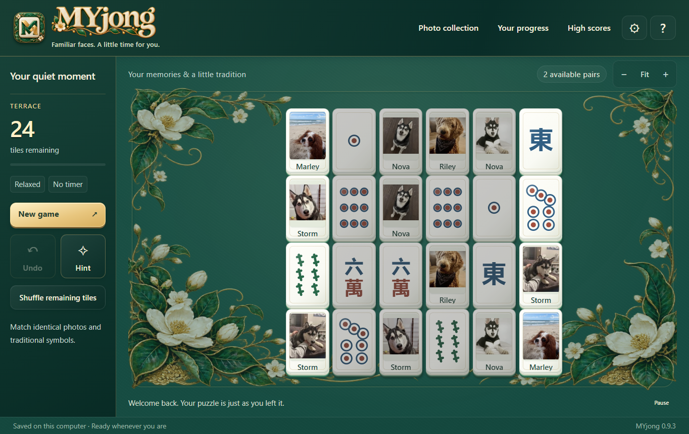
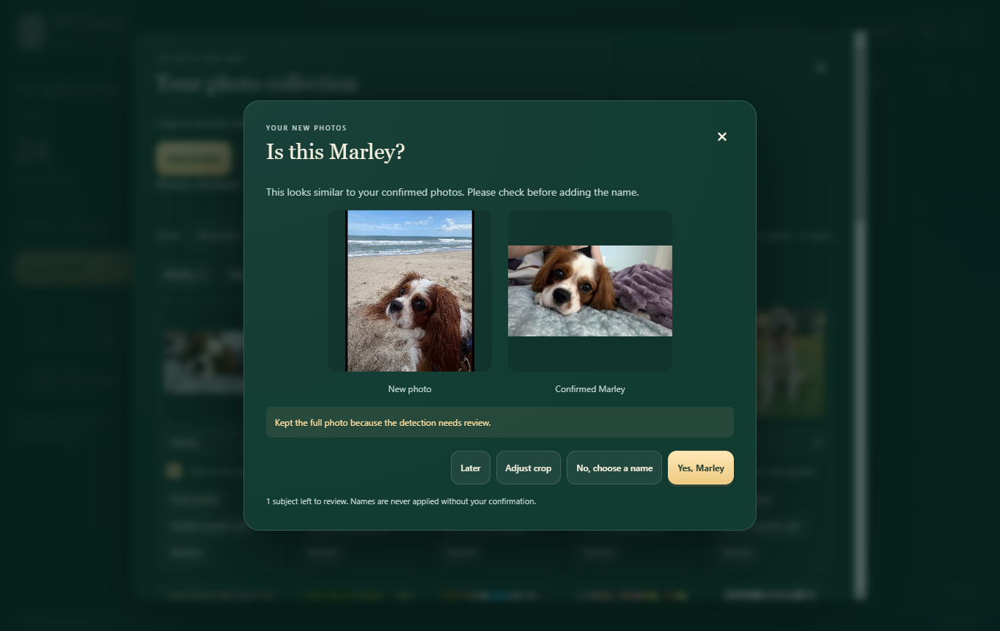

# MYjong

**Familiar faces. A little time for you.**

An offline mahjong solitaire game for Windows, with traditional tiles and photos of the people and pets you love.



Download the Windows installer from [Releases](https://github.com/spasmodic1/MYjong/releases). Install it, open MYjong, and choose two free matching tiles. A tile is free when uncovered and open on its left or right side.

## What's included

- Relaxed, Balanced, and Challenging puzzles; Terrace, Diamond, Butterfly, and randomized terrace layouts. Starting deals are solvable; later choices can leave dead ends.
- 34 traditional tile identities, photo collections, and evenly mixed photo/traditional deals.
- Match identical photos or different photos of the same named person or pet.
- Automatic save/resume, unlimited undo, cycling hints, and an undoable shuffle that seeks a solvable arrangement for the remaining stacks.
- Relaxed play or Challenge play with timer, scoring, personal bests, and small achievements. The timer pauses while a dialog is open, the game is paused, or its window is hidden.
- Four backgrounds, two tile finishes, optional captions and blocked-tile dimming, synthesized matching sounds, and an original optional melody.
- Modern porcelain tiles with large photo/symbol windows, compact controls, matched-pair effects, and Fit/+/− board zoom; motion effects respect the system's reduced-motion preference. See [visual reference notes](./DESIGN-NOTES.md).
- Folder and file importing; JPEG, PNG, WebP, AVIF and HEIC/HEIF conversion; phone uploads over home Wi-Fi through a QR code.
- Editable names, inclusion controls, reassignment, merging, independent copies/crops of group photos, pan/zoom/reset controls, and a full-photo option.
- New photos are analyzed automatically after file/folder import or phone upload. When a pet resembles confirmed library photos, MYjong asks “Is this Marley?” (or the matching name) with a reference picture. Person suggestions use face descriptors. Names always require confirmation; uncertain matches stay unnamed.
- Clear single-subject imports are framed automatically for the tile photo window. Multiple subjects and uncertain detections stay for review; full photos are retained when a safe crop cannot fit. Manual crops, including choosing Full photo, are preserved.
- ZIP backup/restore, with a safety backup before restoring; a Check for Updates button that downloads releases from this repository.

The starter collection contains 21 photos of five pets, supplied and approved by their owner for public distribution. Starter names are editable; any photo or subject can be excluded, and the starter collection can be removed. Original source photos are never modified by importing, framing, or deleting MYjong's copies. Future photos you import remain on your own computer and are never uploaded to GitHub.



The first analysis after launching can take a little longer while the bundled models initialize. Progress appears in the collection window. You can review later without losing an imported photo.

Person suggestions use SSD MobileNet face detection and full 68-point landmarks. Older reference photos are refreshed locally when needed. Confirming a name also helps with later photos in the same upload batch. Photo Collection opens with all photos visible, and the Needs a name filter is disabled when empty.

## Photos and saves

MYjong stores its photo library and saved game under `%APPDATA%\MYjong`, outside the installation folder. Updates and normal uninstalling keep that folder. Use **Settings → Create backup** to save a ZIP containing the collection and game, and **Restore backup** to move it to another computer.

For phone uploads, connect both devices to the same private home Wi-Fi, open **Photo collection → Send from phone**, and scan the QR code. Leave that dialog open. Its link expires after 15 minutes and closes with the dialog. Windows may request firewall access for the private network. Public Wi-Fi, guest networks with device isolation, and corporate networks may prevent the connection. The transfer is direct local HTTP with a randomly generated session link; use a trusted home network. No cloud account is required. Device photo pickers determine how many photos can be selected together. Imports are limited to 40 MB per photo and 500 files per batch.

Recognition can miss faces, confuse people, or miss small/obscured animals. Review suggested names and framing, especially group photos. The pet detector includes cats, dogs, birds and horses. A separate bundled DINOv2 image model compares detected animals with confirmed pet photos; these appearance-based suggestions are tentative, particularly for pets of similar breeds or coloring. MYjong never applies a suggested name without confirmation. You can always assign names and frame photos manually. Crops use the actual 4:5 photo window inside the portrait tile, with the full photo retained separately.

## Development

Use Windows x64 with Node.js 24 or newer:

```powershell
npm ci
node node_modules/electron/install.js
npm start
```

The installed game needs neither Node nor internet. A browser preview can also be served with `python -m http.server 8765 --bind 127.0.0.1`; desktop import, phone transfer, and updates are Windows-app features. Browser preview data uses IndexedDB and is separate from the installed game's files.

```powershell
npm test                 # Rules, deals, saves, crops, library and backups
npm run test:desktop     # Hidden Electron integration test
npm run test:models      # Bundled model inference; rejects remote requests
npm run test:imports     # Real pet-name prompt and manual framing preservation
npm run test:collection  # Filters, naming, reopening and photo preservation
npm run build            # Windows NSIS installer, blockmap and latest.yml
```

Recognition code is compiled into `assets/recognition.js`. Model files are checked in for offline builds; hashes and licenses are under `assets/`. To intentionally refresh models/bundle after dependency changes, run `npm run prepare:models` and review licenses and checksums. Packaging uses an explicit file allowlist. Raw `Photos/`, local photo catalogs, screenshots, app data, and local build directories are ignored. The approved starter collection is deliberately bundled as `assets/starter-collection.zip`.

## Releases and updates

`release-config.json` identifies this repository. The Windows app checks GitHub only when **Settings → Check for Updates** is selected, asks before downloading, and asks before restarting to install. It does not check automatically at startup. Updates preserve app data and never replace an existing photo library with the starter library. First-run starter extraction happens only when no library exists.

To publish the next version, update `package.json` and the lockfile, commit, and push a matching `vX.Y.Z` tag. GitHub Actions tests the app and publishes the installer, blockmap and `latest.yml` to a GitHub release using the workflow's repository token. No GitHub token is embedded in the app. Keep release tags and version numbers aligned. Do not upload backups or personal photo collections to releases unless those particular assets are explicitly approved for distribution.

The review installer is unsigned. Code signing and testing on the recipient's actual laptop remain release-polish tasks. See [third-party notices](./THIRD-PARTY-NOTICES.md) for component licenses. A license for MYjong's own source has not yet been selected; public source visibility does not grant a general redistribution license.
